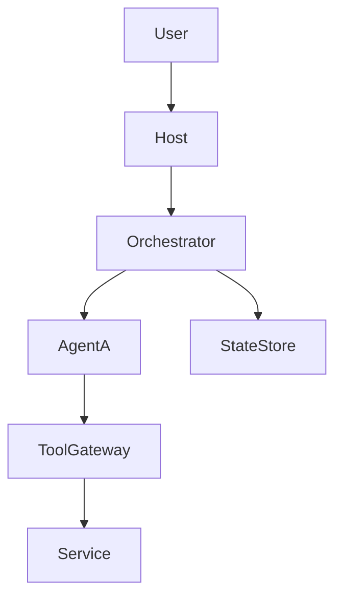

# AI Agent System Design: <system / workflow>

## 1. Goals and constraints
- Business outcome / user journey:
- Task classes and risk tiers:
- Functional requirements:
- Quality, latency, availability, and cost objectives:
- Data classification / tenant boundaries:
- Non-goals and hard constraints:

## 2. Baseline and architecture choice
- Deterministic or single-agent baseline:
- Why multiple agents are/are not justified:
- Chosen topology: Sequential / Router / Supervisor-worker / Parallel fan-out / Peer / Hierarchical
- Alternatives and trade-offs:

## 3. Agent inventory and contracts
| Agent | Responsibility / non-goals | Inputs / outputs | Tools / data scopes | Budgets / stop conditions | Owner |
|---|---|---|---|---|---|
| | | | | | |

## 4. Architecture and execution flow

Replace with the actual design. Mark trust boundaries, synchronous/asynchronous edges, and human approval paths.

## 5. Harness and tools
- Model/provider routing and fallback:
- Context assembly and provenance:
- Tool registry and schema versions:
- Authorization and policy decision point:
- Sandbox, network, filesystem, and resource limits:
- Deadlines, cancellation, retries, and budgets:

## 6. MCP and external integrations
- Host/client/server inventory:
- Capabilities (Tools / Resources / Prompts):
- Transport and identity:
- Per-operation authorization:
- Version compatibility and lifecycle:

## 7. State, memory, and recovery
- Ephemeral context vs history vs memory vs workflow state:
- Source of truth and ownership:
- Checkpoint and resume protocol:
- Idempotency / reconciliation:
- Retention, deletion, and tenant isolation:

## 8. Security and human oversight
- Threat model:
- Least-privilege scopes:
- High-impact approval gates:
- Audit and redaction:
- Incident revocation / kill switch:

## 9. Evaluation and observability
- Versioned evaluation dataset:
- Task success and correctness:
- Safety/policy release gates:
- Latency, tokens, cost, and human intervention:
- Tracing and alerting:

## 10. Failure modes and rollout
- Provider/tool/worker failures:
- Partial completion and ambiguous side effects:
- Canary and rollback:
- Operational owner and runbooks:
