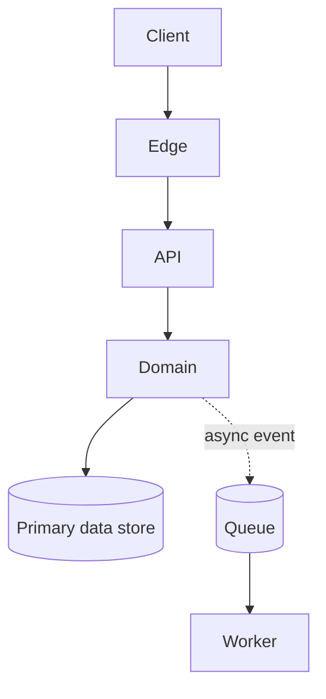

# Architecture Design: <system / feature>

## 1. Executive recommendation

<Recommended approach and why it fits the current constraints.>

## 2. Scope and requirements

### Functional requirements
- 

### Non-functional requirements
| Attribute | Target | Source (measured / user-provided / assumed) |
|---|---|---|
| Latency P95/P99 | | |
| Throughput / peak | | |
| Availability | | |
| Durability / RPO | | |
| Recovery / RTO | | |
| Security / compliance | | |

### Out of scope
- 

## 3. Assumptions and open questions
| Item | Assumption / question | Impact if wrong |
|---|---|---|
| | | |

## 4. Workload and capacity estimate
| Dimension | Estimate | Formula / notes |
|---|---:|---|
| Average RPS | | |
| Peak RPS | | |
| Read/write ratio | | |
| New data/day | | |
| Retention | | |
| Storage + indexes + replicas | | |
| Network | | |

## 5. High-level architecture

Replace this illustrative diagram with the actual design. Mark sync/async flows and trust boundaries.

## 6. Components and ownership
| Component | Responsibility | Data owned | Scale/failure boundary |
|---|---|---|---|
| | | | |

## 7. API and data design

### APIs / events
| Operation | Contract | Idempotency / ordering | AuthZ |
|---|---|---|---|
| | | | |

### Data model and source of truth
- Entities:
- Constraints/invariants:
- Indexes/access patterns:
- Retention/deletion:

## 8. Key design decisions and trade-offs
| Decision | Chosen option | Alternatives | Reason / consequence |
|---|---|---|---|
| | | | |

## 9. Reliability, security, and observability
- Timeouts / retries / idempotency:
- Failure modes / degradation:
- Backup / restore / RPO / RTO:
- Authentication / authorization / secrets:
- Metrics / logs / traces / alerts:

## 10. Rollout, migration, and rollback
1. 

## 11. Validation plan
- Unit/integration/contract tests:
- Concurrency/idempotency/failure tests:
- Load test and success thresholds:
- Operational readiness checks:

## 12. Evolution triggers
- What measured signal would justify the next architectural step?
