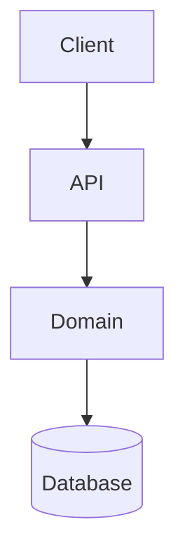

# Architecture Review: <repository / system>

## Scope inspected
- Directories/files/configuration inspected:
- Important areas not inspected:
- Runtime/deployment assumptions:

## Executive summary
<Overall assessment. Separate verified facts from assumptions.>

## Findings

### [Severity] <Finding title>
- **Status:** Confirmed / Likely / Unknown
- **Evidence:** `path/to/file.ext:line` or symbol/config/query
- **Impact:**
- **Trigger / likelihood:**
- **Recommendation:**
- **Validation:**
- **Effort / risk:**

## Architecture map

Replace with observed architecture only.

## Risk register
| Severity | Risk | Evidence | User/business impact | Proposed action |
|---|---|---|---|---|
| | | | | |

## Quick wins
1. 

## Structural improvements
1. 

## Tests / measurements required
- 

## Suggested sequence
| Phase | Change | Success criterion | Rollback |
|---|---|---|---|
| | | | |

## Unknowns
- 
